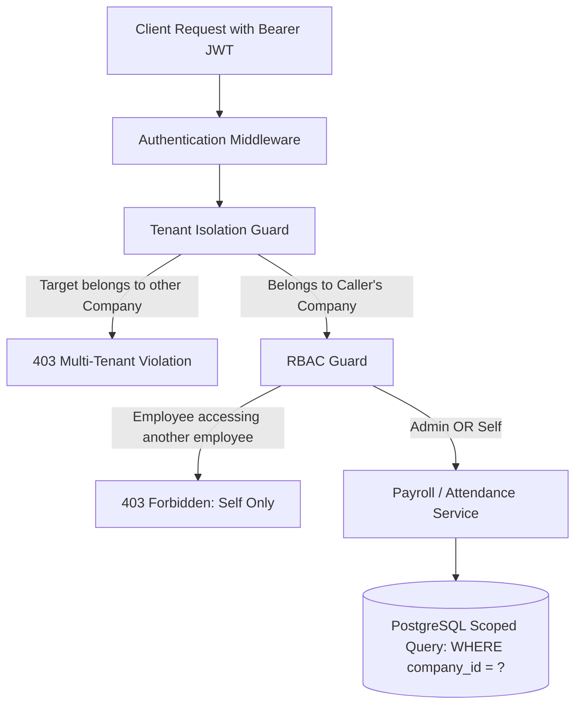

# Multi-Tenant Attendance-to-Payroll System — Design & Architecture Note

## 1. Executive Summary
This project implements a multi-tenant Attendance-to-Payroll API and interactive web application built with **Node.js/Express, TypeScript, PostgreSQL, and React**. The system manages multiple distinct companies (**Tata Technologies** and **Reliance Industries**), each configured with distinct monthly working days, employees, attendance tracking, and automated payroll calculations.

Key capabilities include:
- **Tenant Isolation**: Complete logical data separation ensuring Company A's (Tata Technologies) data can never be viewed, enumerated, or modified by Company B (Reliance Industries).
- **Role-Based Access Control (RBAC)**: Admins can calculate and audit payroll for any employee within their organization; Employees are restricted strictly to their own data.
- **Attendance-to-Payroll Calculation Engine**: Pure, deterministic computation of Loss of Pay (LOP) days, gross salary, standard deductions, and payable net salary.
- **Comprehensive Test Suite**: Automated unit and integration tests covering calculation scenarios, RBAC boundaries, and multi-tenant security.
- **AI Plain-English Query Engine (LLM Tool-Calling)**: Natural language interface resolving queries such as *"What is Ramesh's net salary for October?"* by executing internal API tools while enforcing tenant boundaries.

---

## 2. Multi-Tenant Architecture & Data Isolation

### Tenancy Model Selection
In modern multi-tenant systems, three primary patterns exist:
1. **Database-per-Tenant**: Highest isolation, high infrastructure overhead.
2. **Schema-per-Tenant**: Separate PostgreSQL schemas within one database.
3. **Shared Database, Shared Schema with Discriminator Column (`company_id`) + Scoped Enforcement**: Standard SaaS approach offering high performance, seamless resource pooling, and straightforward indexing.

For this system, we adopted **Shared Schema with Discriminator Column (`company_id`)**, bolstered by a **3-Layer Security Perimeter**:

1. **Authentication Token Binding**: The JWT contains signed, tamper-proof claims: `{ userId, companyId, companyCode, role }`.
2. **Tenant Isolation Middleware (`enforceTenantIsolation`)**: Intercepts every incoming request. If a target employee ID is supplied in the route or request body, the middleware queries the database within the current tenant boundary. If the target employee belongs to another company, the request is immediately rejected with `403 Forbidden` (`Multi-Tenant Isolation Violation`).
3. **Scoped Query Pattern**: All repository queries (`users`, `attendance_records`, `payroll_runs`, `company_working_days_config`) explicitly include `WHERE company_id = $1`.



---

## 3. Data Model (PostgreSQL)

```sql
companies (
    id UUID PRIMARY KEY,
    name VARCHAR(255) NOT NULL,
    code VARCHAR(50) UNIQUE NOT NULL, -- 'TATA', 'RELIANCE'
    default_monthly_working_days INT NOT NULL DEFAULT 22
);

company_working_days_config (
    id UUID PRIMARY KEY,
    company_id UUID REFERENCES companies(id) ON DELETE CASCADE,
    year INT NOT NULL,
    month INT NOT NULL CHECK (month BETWEEN 1 AND 12),
    working_days INT NOT NULL,
    CONSTRAINT uq_company_month_year UNIQUE (company_id, year, month)
);

users (
    id UUID PRIMARY KEY,
    company_id UUID REFERENCES companies(id) ON DELETE CASCADE,
    name VARCHAR(255) NOT NULL,
    email VARCHAR(255) UNIQUE NOT NULL,
    password_hash VARCHAR(255) NOT NULL,
    role VARCHAR(50) NOT NULL CHECK (role IN ('ADMIN', 'EMPLOYEE')),
    designation VARCHAR(100),
    base_monthly_salary NUMERIC(12, 2) NOT NULL
);

attendance_records (
    id UUID PRIMARY KEY,
    company_id UUID REFERENCES companies(id) ON DELETE CASCADE,
    employee_id UUID REFERENCES users(id) ON DELETE CASCADE,
    date DATE NOT NULL,
    status VARCHAR(20) NOT NULL CHECK (status IN ('PRESENT', 'ABSENT', 'HALF_DAY')),
    notes VARCHAR(255),
    CONSTRAINT uq_employee_date UNIQUE (employee_id, date)
);

payroll_runs (
    id UUID PRIMARY KEY,
    company_id UUID REFERENCES companies(id) ON DELETE CASCADE,
    employee_id UUID REFERENCES users(id) ON DELETE CASCADE,
    year INT NOT NULL,
    month INT NOT NULL,
    working_days INT NOT NULL,
    present_days NUMERIC(5, 2) NOT NULL,
    absent_days NUMERIC(5, 2) NOT NULL,
    half_days NUMERIC(5, 2) NOT NULL,
    lop_days NUMERIC(5, 2) NOT NULL,
    gross_salary NUMERIC(12, 2) NOT NULL,
    per_day_salary NUMERIC(12, 2) NOT NULL,
    lop_deduction NUMERIC(12, 2) NOT NULL,
    simple_deduction NUMERIC(12, 2) NOT NULL,
    net_salary NUMERIC(12, 2) NOT NULL,
    calculated_by UUID REFERENCES users(id),
    calculated_at TIMESTAMP WITH TIME ZONE DEFAULT CURRENT_TIMESTAMP
);
```

---

## 4. Role-Based Access Control (RBAC) Matrix

| Endpoint | Method | Admin | Employee | Cross-Tenant |
| :--- | :--- | :---: | :---: | :---: |
| `/api/companies/working-days` | `GET` | ✅ Allowed | ✅ Allowed | ❌ Blocked |
| `/api/companies/working-days` | `POST` | ✅ Allowed | ❌ 403 Forbidden | ❌ Blocked |
| `/api/companies/employees` | `GET` | ✅ Allowed | ✅ Allowed (Own Company) | ❌ Blocked |
| `/api/attendance/:employeeId` | `GET` | ✅ Any Employee | ✅ Self Only | ❌ 403 Forbidden |
| `/api/attendance/:employeeId` | `POST` | ✅ Allowed | ❌ 403 Forbidden | ❌ 403 Forbidden |
| `/api/payroll/calculate` | `POST` | ✅ Any Employee | ✅ Self Only | ❌ 403 Forbidden |
| `/api/payroll/history/:employeeId` | `GET` | ✅ Any Employee | ✅ Self Only | ❌ 403 Forbidden |
| `/api/ai/ask` | `POST` | ✅ Any in Company | ✅ Self Only | ❌ 403 / Isolation Error |

---

## 5. Attendance-to-Payroll Mathematical Model

### Formal Definitions
1. **Working Days ($W$)**: Configured working days for the company in that month (e.g. 22 days for Tata Technologies, 20 days for Reliance Industries).
2. **Gross Monthly Salary ($G$)**: Agreed base monthly compensation.
3. **Daily Salary Rate ($R$)**:
   $$R = \frac{G}{W}$$
4. **Attendance Counts**:
   - $P$ = count of `PRESENT` records
   - $A$ = count of `ABSENT` records
   - $H$ = count of `HALF_DAY` records
5. **Loss-of-Pay Days ($LOP$)**:
   $$LOP = (A \times 1.0) + (H \times 0.5)$$
6. **Loss-of-Pay Deduction ($D_{LOP}$)**:
   $$D_{LOP} = \min(G, \text{round}(LOP \times R, 2))$$
7. **Simple Statutory Deduction ($D_{Simple}$)**:
   Standard 5% deduction (or configurable statutory deduction):
   $$D_{Simple} = \text{round}(G \times 0.05, 2)$$
8. **Total Deductions ($D_{Total}$)**:
   $$D_{Total} = \text{round}(D_{LOP} + D_{Simple}, 2)$$
9. **Net Salary Payable ($N$)**:
   $$N = \max(0, \text{round}(G - D_{Total}, 2))$$

---

## 6. Test Cases & Verification (11/11 Passed)

### Calculation Engine Test Cases (`src/tests/payroll-calculation.spec.ts`)
- **Test Case 1: Full Attendance (Zero LOP)**
  - Inputs: Gross = ₹60,000, Working Days = 22, Attendance = 22 Present, 0 Absent, 0 Half-Day.
  - Results: LOP Days = 0, LOP Deduction = ₹0, Simple Deduction (5%) = ₹3,000, Net Salary = ₹57,000.
- **Test Case 2: Mixed Attendance with Fractional Days (Ramesh's October Scenario)**
  - Inputs: Gross = ₹60,000, Working Days = 22, Attendance = 18 Present, 2 Absent, 2 Half-Days.
  - LOP Days: $2 + (2 \times 0.5) = 3.0$ days.
  - Daily Rate: $60,000 / 22 = ₹2,727.2727$.
  - LOP Deduction: $3 \times 2,727.2727 = ₹8,181.82$.
  - Simple Deduction: $5\% \times 60,000 = ₹3,000.00$.
  - Net Salary: $60,000 - 8,181.82 - 3,000 = ₹48,818.18$.
- **Test Case 3: 100% Absences (Zero Net Floor Protection)**
  - Inputs: Gross = ₹50,000, Working Days = 20, Attendance = 0 Present, 20 Absent.
  - Results: LOP Days = 20, LOP Deduction = ₹50,000, Net Salary = ₹0.00.
- **Test Case 4: Company Working-Days Differences (Reliance 20 Days)**
  - Inputs: Gross = ₹50,000, Working Days = 20, Attendance = 17 Present, 1 Absent, 2 Half-Days (Rohan Verma).
  - LOP Days: $1 + 1 = 2.0$ days.
  - Daily Rate: $50,000 / 20 = ₹2,500.00$.
  - LOP Deduction: $2 \times 2,500 = ₹5,000.00$.
  - Simple Deduction: ₹2,500.00.
  - Net Salary: ₹42,500.00.

### Tenant Isolation & RBAC Test Cases (`src/tests/tenant-isolation.spec.ts`)
- **Requirement 3 (A)**: Admin of Tata can calculate payroll for Ramesh.
- **Requirement 3 (B)**: Ramesh can view his own payroll.
- **Requirement 3 (C)**: Ramesh cannot access Priya's payroll (returns 403 Forbidden).
- **Requirement 4 (A)**: Admin of Reliance cannot access Ramesh (returns 403 Tenant Isolation Violation).
- **Requirement 4 (B)**: Attendance endpoint blocks cross-tenant employee access.
- **Bonus Query Test**: Plain-English query answers Ramesh's net salary with exact numbers.
- **Bonus Query Isolation Test**: Reliance user querying Ramesh returns tenant isolation error.

---

## 7. AI Plain-English Query Engine (Optional Bonus)

### Tool-Calling Architecture
Endpoint: `POST /api/ai/ask`
Payload: `{ "question": "What is Ramesh's net salary for October?" }`

1. **Tool Definition**:
   ```json
   {
     "name": "get_employee_payroll",
     "description": "Calculates and retrieves employee attendance-to-payroll figures",
     "parameters": {
       "employeeName": { "type": "string" },
       "month": { "type": "integer" },
       "year": { "type": "integer" }
     }
   }
   ```
2. **Context-Aware Entity Resolution**:
   - Matches employee name within the caller's tenant boundary.
   - If an employee name from *another* company is detected, it intercepts the prompt and outputs a security alert explaining that multi-tenant rules prohibit cross-company inspection.
   - If the caller is an `EMPLOYEE` asking about someone else, it enforces RBAC.
3. **Execution**:
   - The tool executes `payrollService.calculatePayrollFromAttendance`.
   - Returns structured numbers and synthesizes a natural English explanation.

---

## 8. Instructions to Run

### Backend
```powershell
cd backend
npm install
npm run db:migrate   # creates tables and indexes
npm run db:seed      # seeds Tata & Reliance companies, users, attendance
npm test             # runs all 11 unit & integration tests
npm run dev          # starts backend at http://localhost:5050
```

### Frontend
```powershell
cd frontend
npm install
npm run dev          # starts React dashboard at http://localhost:3000
```
